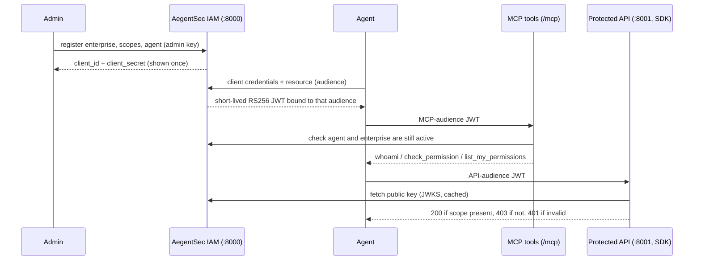

# AegentSec

> Local identity and scoped access for autonomous AI agents, exposed through REST, MCP, and a Python SDK.

## Overview

AegentSec gives each registered agent its own client credentials and approved scopes. An agent exchanges those credentials for a short lived, RS256 signed access token bound to one resource. AegentSec's MCP tools let the agent inspect its own identity and permissions; a separate API uses the SDK to verify the token and enforce scopes independently. This prototype is for developers building agent integrations and reviewers exploring agent authorization.

The core IAM service is separate from MCP. REST and MCP use the same identity and permission rules.

```text
Administrator ──registers──> SQLite enterprise + agent records
Agent ──client credentials──> AegentSec REST ──signed JWT──> Agent
Agent ──MCP audience JWT──> authenticated MCP tools
Agent ──inventory audience JWT──> inventory API ──AegentSec SDK──> allow / deny
                                     SDK ──JWKS──> AegentSec public key
```

## Why it matters

AI agents increasingly call real systems, but they usually borrow a human's API key or share one service account. AegentSec gives every agent its own identity and least-privilege scopes. One signed token works for both MCP tools and any backend, and the backend enforces scopes itself. A prompt-injected or misbehaving agent therefore cannot exceed what an administrator granted, and every issuance and denial is auditable.

### How a request flows



## Features and stack

- FastAPI administrative and OAuth client credentials endpoints.
- SQLite storage with unique client IDs, foreign keys, and Argon2 secret hashes.
- RS256 access tokens, a public JWKS endpoint, exact resource audiences, and exact scope checks.
- Official Python MCP SDK Streamable HTTP server with `whoami`, `check_permission`, and `list_my_permissions`.
- Python SDK with rate-limited JWKS caching and FastAPI scope dependencies.
- Admin-managed scope catalogue (`/api/v1/scopes`).
- Admin deactivate/activate endpoints for agents and enterprises, and an admin-only audit log of registrations, token issuance and denials (never secrets or tokens).
- A deterministic demo that needs no model and proves both permitted and denied actions.

Scopes live in a database catalogue managed by the administrator, so new ones need no code change. Five demo scopes are seeded on startup: `inventory:read`, `inventory:write`, `inventory:delete`, `purchase:read`, and `purchase:create`. A scope must look like `resource:action` (lowercase letters, digits, `_` or `-`). Matching is exact; scopes not in the catalogue and wildcards are denied.

Python 3.12+ and [`uv`](https://docs.astral.sh/uv/) are required. No hosted model, MongoDB, or Docker service is required.

## Install and configure

Run commands from `tools/aegentsec/`:

```bash
uv sync --extra dev
cp .env.example .env
# Edit .env: set ADMIN_API_KEY (32+ characters). Generate one with:
#   python3 -c 'import secrets; print(secrets.token_urlsafe(48))'
uv run --env-file .env python scripts/generate_keys.py
```

Keep `.env`, `keys/`, and `data/` local. The key generation script refuses to overwrite an existing private key. Keep that key between restarts so previously issued tokens remain verifiable.

| Variable | Meaning | Default/example |
| --- | --- | --- |
| `ADMIN_API_KEY` | Admin secret, at least 32 characters; the app refuses to start with a short or placeholder value | Set locally |
| `DATABASE_PATH` | SQLite file | `./data/aegentsec.sqlite3` |
| `IAM_ISSUER` | Exact JWT issuer and REST origin | `http://localhost:8000` |
| `IAM_PRIVATE_KEY_PATH` | Local RSA PEM private key | `./keys/private.pem` |
| `IAM_KEY_ID` | Stable JWKS key ID | `aegentsec-key-001` |
| `JWT_EXPIRATION_MINUTES` | Access token lifetime; keep it short because SDK-protected APIs cannot revoke earlier tokens | `15` |
| `MCP_RESOURCE_URI` | Exact MCP token audience | `http://localhost:8000/mcp` |
| `INVENTORY_API_AUDIENCE` | Exact inventory API token audience | `http://localhost:8001` |

## Run and verify

Start these in separate terminals from the project directory:

```bash
uv run --env-file .env uvicorn aegentsec.main:app --host 127.0.0.1 --port 8000
uv run --env-file .env uvicorn inventory_backend:app --app-dir examples --host 127.0.0.1 --port 8001
```

The IAM OpenAPI UI is at `http://localhost:8000/docs`; MCP is at `http://localhost:8000/mcp`; JWKS is at `http://localhost:8000/.well-known/jwks.json`. The inventory backend is at `http://localhost:8001`.

Then run the complete, repeatable demo:

```bash
uv run --env-file .env python examples/demo.py
```

It creates two agents with distinct credentials, invokes the three MCP tools, and shows inventory read allowed, the Inventory Agent's purchase attempt denied with 403, the Purchase Agent's purchase allowed, and invalid or wrong audience tokens denied with 401. It then deactivates the Inventory Agent: its MCP token and new token requests fail with 401, while its already issued API token still works until it expires (the SDK has no dynamic revocation). Before that it creates a new `ticket:create` scope through the API, issues it to an agent, and shows a wildcard scope being refused. Finally it prints the audit log. The operations return mock data and do not modify a real enterprise system.

### Manual registration and token request

Set `ADMIN_API_KEY` in your shell to the same value as `.env`. Register an enterprise and agent:

```bash
curl -X POST http://localhost:8000/api/v1/enterprises \
  -H "X-Admin-Api-Key: $ADMIN_API_KEY" -H 'Content-Type: application/json' \
  -d '{"name":"Acme Manufacturing"}'

curl -X POST http://localhost:8000/api/v1/agents \
  -H "X-Admin-Api-Key: $ADMIN_API_KEY" -H 'Content-Type: application/json' \
  -d '{"enterprise_id":"<enterprise_id>","name":"Inventory Agent","scopes":["inventory:read"]}'

curl -X POST http://localhost:8000/api/v1/auth/token \
  -u '<client_id>:<client_secret>' \
  -d 'grant_type=client_credentials' -d 'scope=inventory:read' \
  -d 'resource=http://localhost:8001'
```

Manage the scope catalogue (a scope cannot be deleted while any agent holds it):

```bash
curl -X POST http://localhost:8000/api/v1/scopes -H "X-Admin-Api-Key: $ADMIN_API_KEY" \
  -H 'Content-Type: application/json' -d '{"scope":"ticket:create","description":"Open tickets"}'
curl http://localhost:8000/api/v1/scopes -H "X-Admin-Api-Key: $ADMIN_API_KEY"
curl -X DELETE http://localhost:8000/api/v1/scopes/ticket:create -H "X-Admin-Api-Key: $ADMIN_API_KEY"
```

Deactivate or reactivate an agent or enterprise (admin key required), and read the audit log:

```bash
curl -X POST http://localhost:8000/api/v1/agents/<agent_id>/deactivate -H "X-Admin-Api-Key: $ADMIN_API_KEY"
curl -X POST http://localhost:8000/api/v1/agents/<agent_id>/activate -H "X-Admin-Api-Key: $ADMIN_API_KEY"
curl -X POST http://localhost:8000/api/v1/enterprises/<enterprise_id>/deactivate -H "X-Admin-Api-Key: $ADMIN_API_KEY"
curl "http://localhost:8000/api/v1/audit?limit=50" -H "X-Admin-Api-Key: $ADMIN_API_KEY"
```

The registration response is the only time the plaintext client secret is returned. Use a separate token request with `resource=http://localhost:8000/mcp` for MCP. Do not send an MCP token to the inventory API.

### MCP client

The deterministic demo contains a complete authenticated Streamable HTTP client. The essential connection is:

```python
from mcp import ClientSession
from mcp.client.streamable_http import streamable_http_client
import httpx

async with httpx.AsyncClient(headers={"Authorization": f"Bearer {mcp_token}"}) as http:
    async with streamable_http_client(
        "http://localhost:8000/mcp", http_client=http
    ) as (read, write, _):
        async with ClientSession(read, write) as session:
            await session.initialize()
            print(await session.call_tool("whoami", {}))
```

The `mcp_token` must be issued for the MCP audience. MCP calls without a valid bearer token receive HTTP 401.

### Protect another FastAPI API

```python
from fastapi import Depends, FastAPI
from aegentsec_sdk import AegentSecVerifier

app = FastAPI()
auth = AegentSecVerifier(
    issuer="http://localhost:8000",
    audience="http://localhost:8001",
    jwks_url="http://localhost:8000/.well-known/jwks.json",
)

@app.get("/inventory")
async def inventory(identity=Depends(auth.require_scope("inventory:read"))):
    return {"agent_id": identity.agent_id, "material": "RM-1001"}
```

The SDK returns 401 for missing or invalid tokens and 403 for valid tokens without the required scope. It gets the JWKS from the URL configured by the API developer, never from token input.

## Test

```bash
uv run --extra dev pytest -q
uv run --extra dev ruff check src sdk examples tests scripts
```

Tests cover the IAM rules, token issuance and audience checks, JWKS, SDK verification, and the MCP HTTP boundary. The deterministic demo verifies behavior across two running services.

## Security and limitations

The administrator credential is a single local API key. Use HTTPS and stronger administrative authentication in production. Bearer token theft remains possible until expiry. Already issued backend tokens are validated using their signed claims; there is no dynamic revocation. The MCP verifier checks current agent and enterprise status, but the standalone SDK has no database access. This prototype supports only client credentials, one signing key, a single global scope catalogue (not per enterprise), and two configured audiences. OAuth authorization code, PKCE, user consent, dynamic client registration, and interactive MCP login are not implemented. The published authorization server metadata advertises only client credentials.

Future work: an LLM agent example (Google ADK with a local model) that uses the MCP tools, key rotation, secret rotation, backend token revocation, audit log retention and export, richer policy administration, and stronger tenant administration.

This project is contributed under the repository's MIT license.
